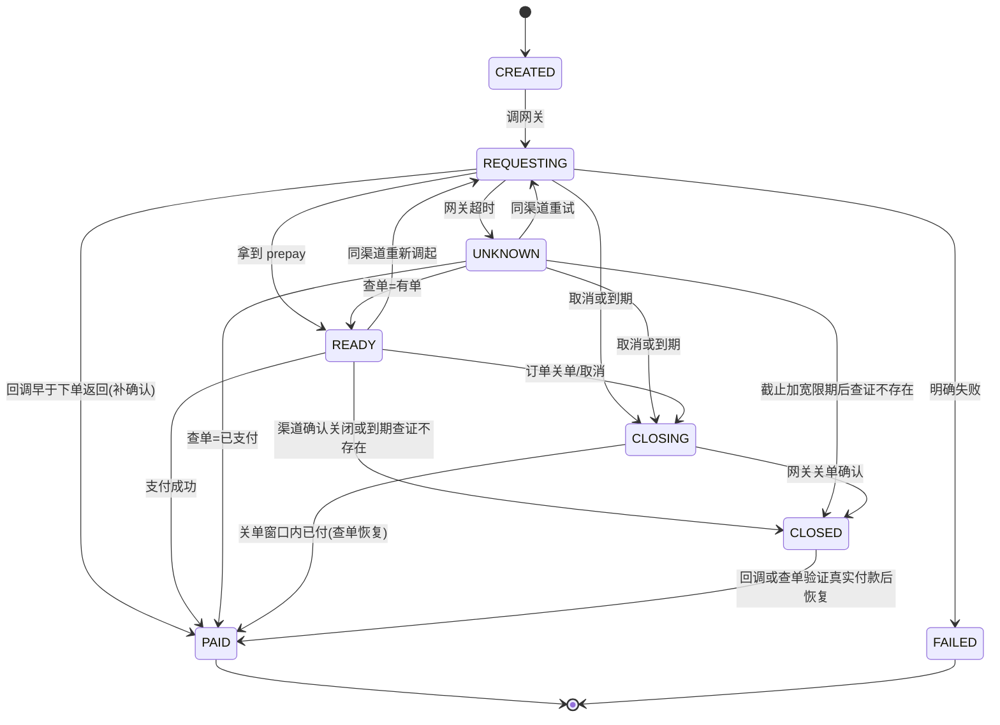
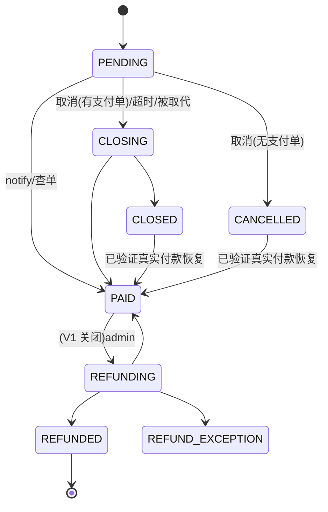

# orderd 详细设计(单一权威文档)

> 订单 + 支付微服务。本文件是**唯一实现依据**,自包含,不引用历史评审版本。
> 配套:`proto/order/v1/*.proto`、`docs/sql/schema.sql`(权威建表草稿,无迁移工具)、`sdk/orderevents/`、`internal/`。
> 状态:架构已通过评审;支付资金主链按本文档 §7–§10 实现后方可编码上线。

---

## 1. 范围与红线

- **范围**:下单 → 支付 → 支付回调 → 全额退款(V1 授权关闭)。支付结果 = 事件推送(主)+ 查询(兜底)。
- **不做**:交付/发权益(接入方)、退款审批(admin)、部分/多次退款(roadmap)。
- **形态**:一个进程、一个库,内部按 `order/payment/refund/event` 模块划分。
- **红线**:能砍就砍,通用性只保留 `metadata` 一个不透明逃生口;资金正确性优先于一切。

---

## 2. 分层(遵循项目 Harness `architecture.md`)

```
cmd/server/                          入口:参数解析 + 启动
internal/
  appmeta/                           常量(APIBasePath / 事件类型等)
  bootstrap/                         进程编排:拿资源 → 调各模块 runtime constructor → 挂 grpc/http/worker
  platform/config/                   配置加载
  platform/data/                     DB/Redis 连接
  pkg/ordernum/                      订单号生成(雪花+前缀,共享)
  models/                            持久化模型 + 枚举(OrderStatus/PayMethod/RefundStatus/AttemptStatus…)
  repository/{order,paymentattempt,refund,transaction,event}/   数据访问(按表/聚合)
  module/order/{application,transport/grpc}/
  module/payment/{application,transport/http}/    (payment 收支付回调=HTTP)
  module/refund/application/
  module/event/{application,worker}/               (outbox 投递 + reconcile 对账 worker)
  runtime/module/{order,payment,refund,event}/     模块装配:config/db → repo/gateway → service
sdk/orderevents/                     接入方消费 SDK + inbox_schema.sql
```

**边界铁律**:`application` 禁 import gorm / repository / gin;`worker` 只依赖 application;`runtime` 只做创建+适配+注入(repository 实现在 `repository/`);`repository` 禁反向依赖 module。

---

## 3. 数据模型(orderd 自有 9 表 + 接入方 1 表)

| 表 | 作用 | 关键约束 |
|---|---|---|
| `orders` | 订单主表 + 金额/账号快照 | `UNIQUE(app_id, idempotency_key)`、`UNIQUE(app_id, client_order_no)`、`CHECK(original-discount=payable)`、`aggregate_version` |
| `payment_attempts` | 支付尝试状态机 | `active_order` 生成列唯一(同时一个活跃)、`out_trade_no` 唯一 |
| `payment_transactions` | **不可变**财务流水 | `UNIQUE(channel, pay_account_id, transaction_id)` |
| `refunds` | 退款执行 | `active_guard` 生成列唯一(活跃退款唯一)、`UNIQUE(app_id, out_refund_no)` |
| `order_events` | **不可变**事件历史 | 自增 id 单调游标、`(app_id, id)` 索引 |
| `event_outbox` | 投递任务(可清理) | 租约 `locked_by/until`、退避 |
| `app_pay_accounts` | 多租户支付账号 | `UNIQUE(notify_route_id)` |
| `app_endpoints` | 回调地址 + 轮换密钥 | — |
| `order_logs` | 状态流转日志 | — |
| `inbox_events`(接入方库) | 权益发放幂等真相源 | `PRIMARY KEY(event_id)` |

MySQL **8.0.16+**(CHECK / 生成列唯一 / SKIP LOCKED)。

---

## 4. gRPC 契约(`proto/order/v1`)

`CreateOrder` · `GetOrderStatus` · `CancelOrder` · `RefundOrder`(V1 授权关闭)· `GetRefund` · `ListOrderEvents`。protovalidate 校验单字段;跨字段与策略在 service 层。

---

## 5. 幂等三件套

1. `idempotency_key` — `UNIQUE(app_id, idempotency_key)`;
2. `request_hash` — **确定性序列化**后 **SHA-256**。字段全集(按固定顺序,覆盖所有影响订单语义的字段):
   `app_id, user_id, product_id, product_title, business_type, original, discount, payable, currency, pay_method, channel_id, client_order_no, metadata_type, metadata_version, sha256(metadata)`;
   序列化用**长度前缀**(字符串/字节写 8 字节大端长度 + 内容,整数写 8 字节大端定宽),**不用 `|` 拼接**——消除字段边界歧义。不含 request-id/时间等瞬态字段。
   同 key 同 hash→复用;同 key 异 hash→`AlreadyExists(IDEMPOTENCY_CONFLICT)`;空 `idempotency_key`/`client_order_no` 必须归一化为 SQL `NULL`(否则 `(app_id,'')` 唯一索引使每 app 只能建一条空键订单);
3. `payment_attempts` — 订单与尝试分表,处理"结果未知"窗口(§9)。

---

## 6. 金额权威 + 多租户账号 + 微信 V3 回调

- **金额**:`Money{original,discount,payable,currency}` 不变量 `original-discount=payable`;每 app 业务白名单 + 金额上下限;财务快照独立于 `metadata`。
- **多租户账号**:go-pay `paymgr.Manager` 单渠道单 Provider 会覆盖 → `payment.Router` 每账号独立 Provider;下单冻结 `pay_account_id/mch_id/pay_app_id/config_version`;**查单/关单用下单冻结账号,退款用"成功交易账号"**——即订单 `settled_*` 快照(支付成功时写入胜出 attempt 的账号,可能是换渠道后第二 attempt 的账号,而非下单首账号,见评审 #6);证书/私钥不落库(`config_ref` 指密钥系统,`config_version` 轮换)。
- **微信 V3 回调**(商户号在 AES-GCM 密文里,验签前不可知):
  ```
  /notify/wechat/{notify_route_id}    /refund-notify/wechat/{notify_route_id}
  route_id → 定位账号+Provider → 验签解密 → 再核对通知内 mchid/appid 与账号一致
  ```
  `notify_route_id` 不透明、非安全凭证;账号停用后仍保留到全部历史订单/支付/退款进终态。

---

## 7. 支付成功核心事务(资金主链,必须单事务)

支付回调或主动查单确认成功时,以下操作在**同一 MySQL 事务**内完成,任一步失败整体回滚:

```
BEGIN
  SELECT orders / payment_attempts ... FOR UPDATE          -- 锁行
  校验 app_id / pay_account_id / out_trade_no / 金额 / 币种  -- 一致性
  payment_attempts: 该尝试 -> PAID
  INSERT payment_transactions (UNIQUE(channel,pay_account_id,transaction_id))
  orders: CAS PENDING/CLOSING/CLOSED -> PAID, aggregate_version + 1
  INSERT order_logs
  INSERT order_events (历史) + INSERT event_outbox (投递)
COMMIT
```

- **重复回调**:命中 `payment_transactions` 唯一键 → 重读原流水校验订单/金额/账号全一致;不一致 = 高等级**资金异常告警**。
- **唯一成功交易**:CAS `-> PAID` 只有一个胜出;胜出后**关闭其他所有活跃 payment_attempts**;胜出时把成功账号写入订单 `settled_*` 快照(退款以此为权威,见 §10)。
- **资金真相必落库(不静默、不因订单不改而回滚丢证)**:"任一步失败整体回滚"仅指胜出交易自身的多表写要么全成要么全不成;它**不**意味着可以把一笔网关已确认的真实资金丢弃。因此:
  - 订单已由另一交易支付(第二笔真实付款)→ 仍 `INSERT payment_transactions(anomaly=1)` 并**提交**,不再改订单、不再发 `order.paid`,提交后高等级告警;
  - 金额/币种/账号与订单快照不一致的真实交易 → 同样落 `anomaly=1` 流水后提交并告警,不回滚丢弃。
  实现上:异常分支在事务内追加不可变流水后**正常提交**(返回 nil),异常事实通过结果标记在事务外告警。

---

## 8. CancelOrder(串行化,资金竞态)

判活与置状态必须**同一事务**,否则并发建尝试会导致取消后仍调网关:

```
BEGIN
  SELECT orders ... FOR UPDATE; 确认 status=PENDING
  查活跃 payment_attempt
    无活跃 -> CAS PENDING -> CANCELLED
    有活跃 -> CAS PENDING -> CLOSING(user_cancel)   -- 网关关单+查单由 reconcile 确认
COMMIT
```
**创建支付尝试也必须锁同一订单行并确认 PENDING**(仅"活跃尝试唯一索引"不能解决取消 vs 建尝试的竞争)。

---

## 9. 支付尝试状态机(资金主链)



**UNKNOWN 策略(不能"查不到就换号")**:`UnifiedOrder` 超时后,单次 `QueryOrder=不存在` 不能证明原请求未被受理。
```
UNKNOWN → 多次查单 + 退避观察窗口
        → 仍不存在 → 优先按【同 out_trade_no】重试 UnifiedOrder
        → 明确已关闭，或达到 ExpireAt+ExpireGrace 且不存在 → 才允许新 attempt + 新 out_trade_no
```
按微信/支付宝各自幂等语义分别定义,不用通用"查不到就换号"。旧尝试关闭后若晚到支付成功 → 走 §7 CAS 决唯一成功 + 关其他活跃尝试。

**8 语义决策**:一订单可多尝试;同时只 1 个活跃(生成列唯一);换支付方式=开新尝试(旧关单)+ 新账号;`out_trade_no` 归尝试;参数丢失→UNKNOWN→查单;取消→所有活跃尝试关单。

---

## 10. 退款闭环(V1 授权关闭)

- **V1 双重关闭**:退款仅在 `refund.enabled=true` 配置开关 **且** 调用方持有 `refund:execute` 权限时才允许;两者缺一即拒。V1 两者都不给(`enabled=false` 且不发放权限),故退款关闭;admin 退款审批模块上线时同时打开二者。配置开关在 service 层校验,权限在 transport 层校验。
- **订单侧**:`PAID` →CAS→ `REFUNDING` → `REFUNDED`(成功)/ `PAID`(失败回退)/ `REFUND_EXCEPTION`(异常人工)。
- **单笔退款**:`CREATED → PROCESSING →(UNKNOWN 查单)→ SUCCEEDED/FAILED/CLOSED/ABNORMAL`；CREATED 已落库而受理写回尚未完成时，也允许按真实结果直接进入 SUCCEEDED/ABNORMAL，或在确定未发出/明确拒绝时进入 FAILED。
- **并发**:先 CAS `PAID→REFUNDING` 与建退款记录同事务;`active_guard` 活跃退款唯一(失败可重提);`UNIQUE(app_id,out_refund_no)` + 退款 `request_hash`;超时进 PROCESSING 主动查单,不盲目再退。
- 退款查询次数与连续不存在证据分开持久化；渠道受理证据不会被后续否定查询清除，任何退款连续不存在达到阈值都转 ABNORMAL 保留守卫等待人工核实。
- 支付宝退款流水使用 `refund:<out_refund_no>`，避免原支付交易号与渠道退款号相同产生唯一键冲突；冲突必须核对身份、金额和币种。
- 同退款幂等键在资金聚合锁内重查，相同请求复用同号；负面查单写回校验每次认领的唯一 token。微信独立退款通知尚未接入，当前退款由主动查单收敛。

---

## 11. 事件:版本协议 + inbox 消费 + 历史

- **信封**:`event_id`、`aggregate_version`(状态跃迁 +1)、`previous_status`、`current_status`、`schema_version`;事件是**完整状态快照**(非增量命令)。
- **接入方 inbox 事务消费**(权益幂等真相源):同事务 `INSERT inbox_events`(唯一键)+ 版本单调校验 + 发/回退权益 + 提交后才回 2xx。Redis 只能加速。
- **两处落库**:`order_events`(不可变历史,游标查询源)+ `event_outbox`(投递任务,可清理)。`ListOrderEvents` 查 `order_events`,自增 id 单调游标,分页上限 1000,游标保留周期 ≥ 接入方最长可恢复中断时间。

---

## 12. Outbox 投递

租约抢占(`locked_by/until` 或 SKIP LOCKED,多副本安全)+ 退避+抖动 + 死信告警 + 死信重放;webhook = `HMAC(timestamp+"."+body)` + `key_id` 轮换 + 时间窗口;SSRF **allowlist**(出口域名/IP 白名单,兼容内部 BFF 私网,而非无条件拒私网)。

死信重放(已实现,AdminService + 兜底 worker):
- **人工重放** `RequeueDeadLetter`:仅 Dead 可重放,置回 Pending 并立即到期;`attempts` 不重置——
  **一次重放 = 一次投递机会**,再失败立即回死信并告警(转死信时落最终 attempts,计数器跨重放单调);
- **定时兜底重放**(配置 `outbox.deadletter.*`,默认关闭):满足冷却(`updated_at` 早于 now-cooldown)、
  次数上限(`attempts < MaxAttempts+MaxAutoRequeues`)与存活上限(`created_at` 晚于 now-max_lifetime)的
  死信自动置回 Pending;认领用 FOR UPDATE SKIP LOCKED,与 actor=system 的审计同事务(多副本恰好一次);
  达任一上限永久停手,人工重放仍可用;
- 重放使用原 `event_id` 与 payload 原文投递,服务端不做投递去重(至少一次语义,幂等真相源在接入方 inbox)。

---

## 13. 授权

方法级权限 + `app_id` 由 token claims 注入(非请求参数):

接入方契约(OrderService):

| 权限 | 方法 | 备注 |
|---|---|---|
| order:create/read/cancel | CreateOrder/GetOrderStatus/CancelOrder | GetOrderStatus/CancelOrder 另校验订单所属用户 |
| refund:execute/read | RefundOrder(V1 不发放)/GetRefund | refund:execute 写审计 |
| event:read | ListOrderEvents | 游标补投 |

运维契约(AdminService,仅 gRPC,不挂 REST;权限不进接入方 token 模板,发放与 refund:execute 同级审批):

| 权限 | 方法 | 备注 |
|---|---|---|
| ops:reconcile | ListReconcileDiffs/HandleReconcileDiff | 处置写 ops_audit_logs(同事务) |
| event:requeue | ListDeadLetters/RequeueDeadLetter | 重放写 ops_audit_logs(同事务) |
| ops:txn:read | ListAnomalyTxns | anomaly 流水查询(含 anomaly_kind 成因) |

BFF token 只能访问其 claims 允许的 app_id;token 校验 issuer/audience/expiry + 轮换。
AdminService 列表的 app_id 为可选查询过滤(空=全域,含跨租户共享账号的空 app_id 记录),不按 token
二次裁剪——访问控制落在运维权限发放边界;每次写动作入 `ops_audit_logs`(actor 取自 token,不可伪造)。

---

## 14. 生产能力(V1 上线前必须)

- DB 备份 + **恢复演练**、迁移回滚;
- **支付渠道账单对账**:每日 CLI/worker 拉取渠道账单 → `reconcile_batches`(批次唯一 + 防重)→ 差异写 `reconcile_diffs`(长款/短款/金额不一致)→ 告警 + 人工处理入口(已实现:AdminService 差异清单/处置,状态机 0待处理→1处理中→2已解决/3已忽略,终态不可改、已忽略必留备注、处置人取自 token、并发锁行串行化、处置与审计同事务);
- **对账恢复边界**:真实支付宝/微信源通过验签元信息、受限下载与完整文件验证后封存逐行证据，支付/退款按完整身份和本金核对。算法修订号隔离旧支付批次，执行token与源/比较代次分离，分页检查点可续跑；新流水同事务写本地核对唤醒，覆盖迟到提交与跨日退款。完整已发布差异才允许独立成功查单补偿，复用既有确认事务且默认关闭；负面/不确定查询不改资金。配置、资源预算、迁移顺序及真实商户上线阻塞见 `docs/reconciliation-rollout.md`。
- 告警:Outbox 死信 / 最老积压时间 / 支付失败率 / 已支付事件未投递(**不是** "PAID 未 Delivered"——orderd 无 Delivered、不发权益)。
- 后续增强:跨地域灾备、自动长短款处理、复杂报表。

---

## 15. 订单状态机



---

## 16. 迁移顺序(强一致 → 最终一致)

现有 `FinalizePaidOrder` 一个事务改订单+账单+会员(订单库=用户库),微服务化是重新设计+测试:
1. 单体内先解耦"支付确认/会员发放"为 Outbox+MySQL Inbox,验证最终一致;
2. 完成 orderd 模型;3. 只新订单进 orderd,旧单处理到终态不迁移;4. 前缀/source_system 路由;
5. admin 走 RPC/只读投影禁直连;6. 账务核对后删旧代码;7. 回滚只切新订单入口。

---

## 17. 测试矩阵(门禁必测,table-driven,核心覆盖率 ≥ 80%,`make check`)

并发同幂等键 / 同键异金额 / 网关受理超时 / 回调早于下单返回(attempt=REQUESTING)/ 查单先无后有 / 新尝试后旧尝试晚到支付 / 两渠道都真实付款 / Outbox 已发未标 delivered 崩溃 / inbox 已提交但 webhook 响应丢 / refunded 高版本先于 paid / 取消与支付并发 / 建尝试与取消并发 / 两退款号并发全额退 / 退款超时网关已受理 / transaction_id 重复但订单异 / client_order_no 跨 app 相同 / 密钥轮换后历史退款 / 微信回调路由错账号 / Outbox 清理后旧游标补拉 / 跨租户越权 / webhook 重放/DNS rebinding/响应体超限 / worker 租约到期抢占崩溃恢复。

门禁:`buf lint` + `buf breaking` + 架构检查 + golangci-lint + `go test -race` + MySQL 集成 + 支付网关故障注入。

---

## 18. 部署要点

- **machineID**:多副本用 **StatefulSet ordinal 静态分配**(选定此方案;若改 UUIDv7 则订单号不再需要 machineID);
- worker 单活或幂等(outbox 租约、reconcile CAS);连接池 + 优雅关闭;
- 独立库备份 + PITR + 账务对账目标。

---

## 19. Roadmap(V1 不做)

部分/多次退款(累计不变量)、admin 退款审批改造(退款随此启用)、ordernum 抽共享库、跨地域灾备/自动长短款/复杂报表。
